<p align="center">
  
</p>

<h1 align="center">Ghulam Mustafa</h1>
<p align="center"><strong>AI / ML Researcher · Developer · Curious by default</strong><br />Exploring intelligent systems and building useful tools from Pakistan.</p>

<p align="center">
  <a href="mailto:mustafa39078@gmail.com"></a>
  <a href="https://www.linkedin.com/in/ghulam-mustafa-3a45582aa/"></a>
  <a href="https://github.com/Mian-Mustafa?tab=repositories"></a>
</p>

---

### `01 / about me`


I explore how machine learning can turn data into useful experiences. My interests span **deep learning**, **natural language processing**, and **voice-driven applications**.

- **Building** → web tools with a focus on monetization.
- **Learning** → deep learning, core AI concepts, and NLP research.
- **Collaborating** → breast cancer classification using SVM.
- **Seeking input** → deep learning projects and my JARVIS voice-command project.

<br clear="both" />

### `02 / project spotlight`

<table>
  <tr>
    <td width="50%" valign="top">
      <h3>🧬 Breast Cancer Classification</h3>
      <p>Exploring breast cancer classification with support vector machines.</p>
      <p><code>Machine Learning</code> <code>SVM</code> <code>Classification</code></p>
      <a href="https://github.com/Mian-Mustafa/Breast-Cancer-Classification-Using-SVM"><strong>Explore the project ↗</strong></a>
    </td>
    <td width="50%" valign="top">
      <h3>🎙️ JARVIS Voice Commands</h3>
      <p>Exploring voice-command detection and interactions with Python.</p>
      <p><code>Python</code> <code>Voice Commands</code> <code>Automation</code></p>
      <a href="https://github.com/Mian-Mustafa/JARVIS--Voice-Command-Detection--Python"><strong>Explore the project ↗</strong></a>
    </td>
  </tr>
</table>

### `03 / technical toolkit`

| Focus | Languages, frameworks & tools |
| :--- | :--- |
| **🧠 AI & data** | Python · TensorFlow · scikit-learn · pandas · Seaborn · MATLAB |
| **🌐 Web development** | JavaScript · React · Node.js · Django · PHP · HTML · CSS · Tailwind CSS · Bootstrap |
| **📱 Mobile & hardware** | Flutter · Dart · Android · Java · C++ · Arduino |
| **🗃️ Databases & cloud** | PostgreSQL · MySQL · MongoDB · Microsoft SQL Server · Firebase · AWS |
| **🛠️ Workflow & design** | Git · Linux · Cypress · Figma |

### `04 / current trajectory`

```text
  EXPLORE                 EXPERIMENT               BUILD
  AI foundations    ───▶  ML classification  ───▶  Useful web tools
  NLP research      ───▶  Voice commands     ───▶  JARVIS
                 learn · test · refine · repeat
```

### `05 / find me online`

[LinkedIn](https://www.linkedin.com/in/ghulam-mustafa-3a45582aa/) · [X](https://x.com/musa39078) · [YouTube / Codegenic](https://www.youtube.com/@codegenic-804) · [Instagram](https://www.instagram.com/mian_mustafa92/) · [Facebook](https://www.facebook.com/ghulam.mustafa.699004) · [Discord](https://discord.gg/CwdvpJvC)

Interested in AI, ML, or a useful tool we could build together? **[Let's connect →](mailto:mustafa39078@gmail.com)**

---

<p align="center"><samp>LEARN → EXPERIMENT → BUILD → ITERATE</samp><br /><sub>Ghulam Mustafa · Pakistan</sub></p>
